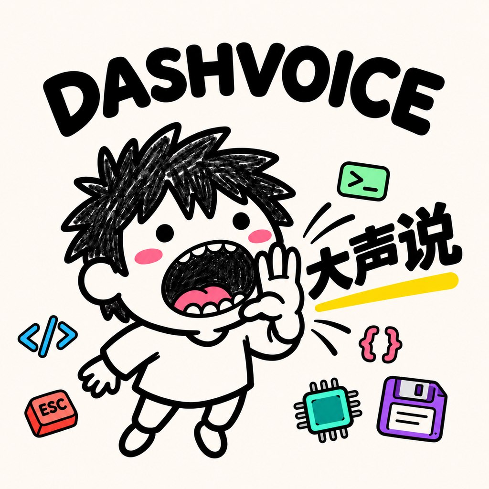

# DASHVOICE



[中文说明](README.md)

DashVoice is a macOS menu-bar dictation app. Press `⌥Space` to record and press it again to stop. DashVoice sends the recording to Alibaba Cloud Model Studio for transcription and types the result into the original field when it can verify the target. It copies the result to the clipboard when the target cannot be verified.

This is a **source beta under the MIT license**. The development build was tested on macOS 13 Ventura on Intel. The declared minimum is macOS 12. Apple Silicon and other macOS versions are unverified.

## Build from source

You need Xcode Command Line Tools and your own DashScope API key.

```bash
git clone https://github.com/yiyi19119-boop/OpenRoadLab-DashVoice.git
cd OpenRoadLab-DashVoice
scripts/build.sh
```

The build produces `build/DashVoice.app`. To sign locally and install to `/Applications`:

```bash
scripts/sign.sh --mode local --bootstrap
scripts/install.sh
open /Applications/DashVoice.app
```

Grant Microphone access when prompted. For automatic typing, add DashVoice under Privacy & Security → Accessibility. Enter your own API key in the app's Settings. DashVoice stores it in a dedicated Keychain item. The source ships without a key.

## Models and privacy

The default model is `qwen3-asr-flash`. The settings retain the `qwen-audio-3.1-asr-flash` option for future integration. It does not work with the current compatible endpoint. Use the default model for dictation.

Recordings go to the configured transcription endpoint, and the provider bills your account. See the [privacy notes](docs/PRIVACY.md) and [permissions guide](docs/PERMISSIONS.md).

## Offline tests

```bash
swiftc -O Sources/DashVoiceCore/*.swift Sources/DashVoiceTests/main.swift -o /tmp/dv-tests
/tmp/dv-tests
```

[MIT](LICENSE) © OpenRoad Lab.
