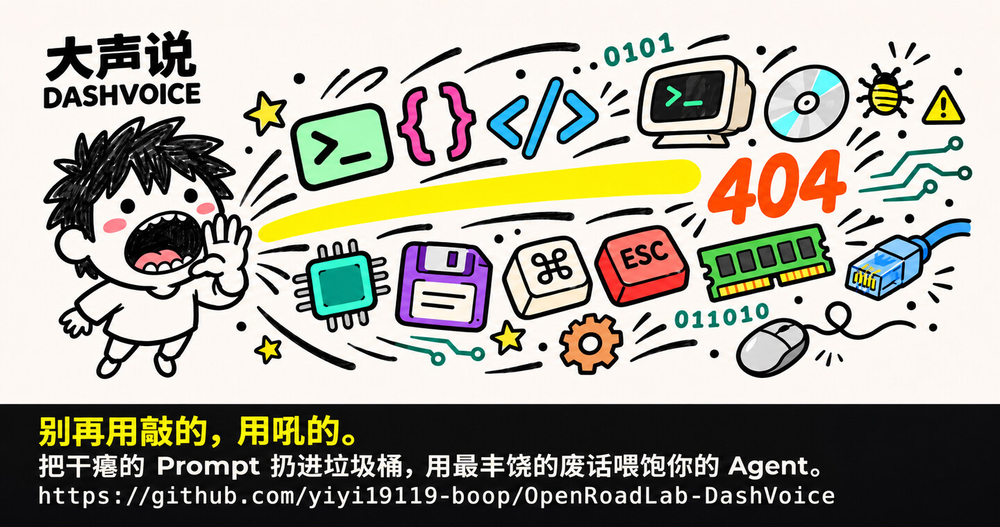
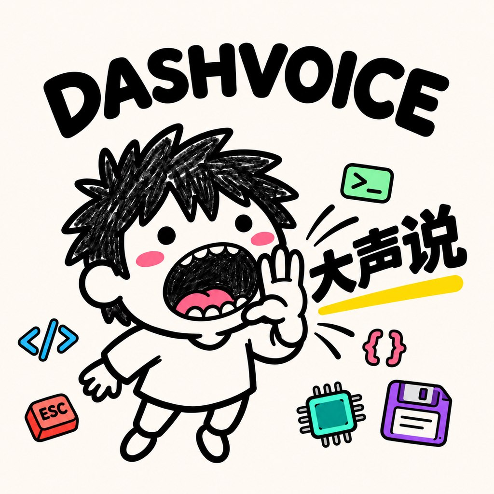

# 大声说 DASHVOICE

[](https://github.com/yiyi19119-boop/OpenRoadLab-DashVoice)



[English README](README.en.md)

大声说是一个 macOS 菜单栏语音输入工具。按 `⌥Space` 开始录音，再按一次停止。它会把录音发到阿里云百炼转成文字，并将结果键入原输入框。无法确认输入框时，结果复制到剪贴板。

这是 **MIT 源码 Beta**。开发实测环境为 macOS 13 Ventura / Intel，最低系统版本声明为 macOS 12。Apple Silicon 和其他 macOS 版本尚未验证。

**安装方式**　当前提供源码，请在 Mac 上按步骤自行构建。 [跳到安装步骤](#从源码构建)

## 首发宣言

> **《大声说 DASHVOICE：对硅基世界的一次物理越权》**
>
> 自图灵时代起，人类就在委屈自己。为了迎合死板的机器，我们发明了汇编、C++，把鲜活的思想压缩成几行干瘪的 Prompt。我们小心翼翼地敲击键盘，生怕多打了一个空格。
>
> 但时代变了。当 Transformer 承载着几千亿参数的暴力算力降临，**机器的阅读理解能力，早已超越了人类的打字速度。**
>
> 「大声说 DASHVOICE」诞生于一台早已落后于时代的 Intel Mac。它从菜单栏冲进日常工作流，让你对着支持的输入框直接开口。它的逻辑极其狂妄：**既然 AI 算力无穷，凭什么还要人类去精简语言？**
>
> 把那些寒暄、前因后果、碎碎念，统统大声说出来。**因为废话，就是喂给 Agent 最顶级的上下文；含糊的指令，才是赛博灾难的源头。**
>
> 这不仅是一个语音输入法，这是人类向机器递交的休战协议：**自然语言即最高指令，让机器去适应人的狂野，而不是人去适应机器的死板。**

上面是品牌宣言。预览版通过 macOS 辅助功能确认输入目标，能确认才自动键入。微信等无法确认目标的场景使用剪贴板。

## 生存指南

**下载、安装，或者对着电脑大吼之前，先花半分钟，免得把赛博小事搞成赛博惨案。**

### 1. 苹果门卫问你是谁

这是在一台老 Intel Mac 上手搓出来的源码 Beta。按下面的步骤从本仓库构建，可以用自己的本机身份签名。macOS 要是说「无法验证开发者」，确认来源可信、文件完整后，再看「隐私与安全性」里有没有「仍要打开」。要是它说「应用已损坏」，回这里重新构建。对着苹果门卫吼一句「我是这台电脑的主人」可以解气，修包还得靠终端。 [Apple 的打开指引](https://support.apple.com/zh-cn/102445)

### 2. 嗓门可以大，删除范围要小

大声说负责把声音变成字，回车由你来按。「把没用的东西都清理掉」这句话，在你脑子里可能是三个旧文件，在有权限的 Agent 那里可能是整个桌面。发送前扫一眼转写，尤其是让它删东西、改代码或运行命令的时候。软件按现状提供，担保与责任条款见 [MIT 许可证](LICENSE)。

### 3. 风扇免费加班，API 另算

程序免费开源。默认用你自己的百炼账号做语音识别，按音频时长和账户规则计费。把转写再发给 Agent，模型费用按那个服务自己的规则算。废话可以很丰饶，账单也可以。 [百炼计费说明](https://help.aliyun.com/zh/model-studio/model-pricing)

录音默认直发阿里云百炼做转写。项目没有自建语音中转，百炼按自己的服务条款处理录音。Key 留在自己的钥匙串里。来 [Issues](https://github.com/yiyi19119-boop/OpenRoadLab-DashVoice/issues) 报问题时，带上 macOS 版本和复现步骤就够了，Key、原始录音和私人转写留在自己手里。 [隐私与数据](docs/PRIVACY.md)

### 4. 输入框认不出你，剪贴板接班

在测过的 Firefox 和微信场景里，自动键入没接上，识别好的字可以从剪贴板粘贴。这个小工具先在老 Intel Mac 上跑了起来，遇到别的情况欢迎来报。想自己改就 fork，想一起改就提 PR，觉得好用就顺手点个 Star。

**去吧，把那些憋在键盘里的干瘪 Prompt，大声吼出来！**

## 从源码构建

需要 Xcode Command Line Tools 和自己的阿里云百炼 DashScope API Key。

```bash
git clone https://github.com/yiyi19119-boop/OpenRoadLab-DashVoice.git
cd OpenRoadLab-DashVoice
scripts/build.sh
```

构建生成 `build/DashVoice.app`。如需签名并安装到 `/Applications`，可在本机运行：

```bash
scripts/sign.sh --mode local --bootstrap
scripts/install.sh
open /Applications/DashVoice.app
```

首次录音时允许麦克风权限。若要启用自动键入，在系统设置的「隐私与安全性 → 辅助功能」中添加 DashVoice。进入菜单栏「设置」填写你自己的 API Key。应用将它保存到专用钥匙串条目；源码未内置 Key。

## 使用与限制

- 点击菜单栏图标、悬浮按钮或按 `⌥Space` 开始和停止录音。停止后收到的文字可以自动键入、预览或复制。
- 自动键入前逐批核对原输入框。切换焦点、进入安全输入或目标不可读时，停止自动键入。微信等无法读取输入框的应用可用剪贴板。
- **识别模型**　日常使用选默认的 `qwen3-asr-flash`，这是当前实测可用的模型。`qwen-audio-3.1-asr-flash` 保留给后续接入，当前接口未接通。
- 录音会发送到配置的识别服务；云端费用按你自己的账户计费。见[隐私与数据](docs/PRIVACY.md)和[权限与签名](docs/PERMISSIONS.md)。

## 离线测试

如果你改了代码，可以用这组测试检查流式响应解析、文本清理和输入目标判断。测试用模拟数据，不发送录音、不消耗 API 额度。

```bash
swiftc -O Sources/DashVoiceCore/*.swift Sources/DashVoiceTests/main.swift -o /tmp/dv-tests
/tmp/dv-tests
```

使用问题可查阅[排障指南](docs/TROUBLESHOOTING.md)，安全问题见[报告说明](docs/SECURITY.md)。

## 许可证

[MIT](LICENSE) © OpenRoad Lab。
